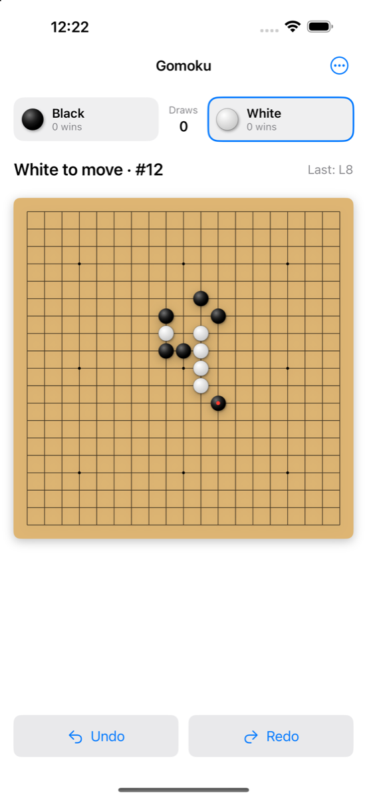
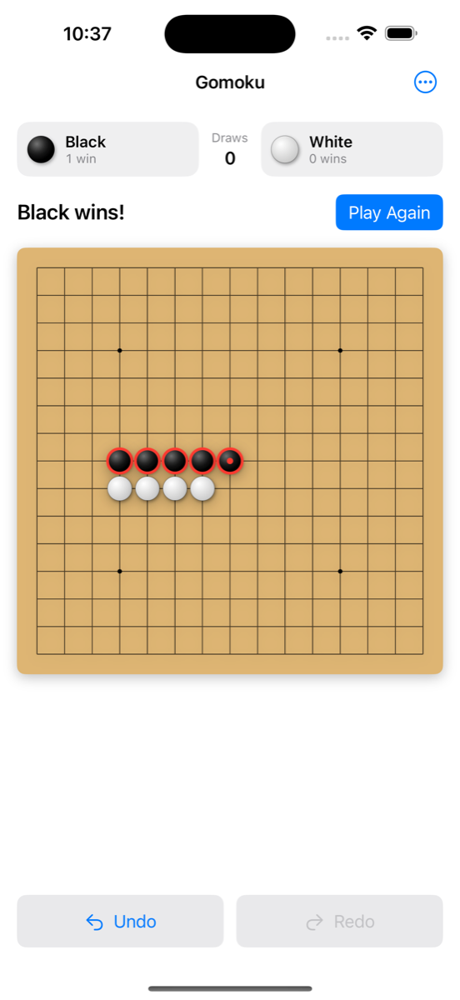
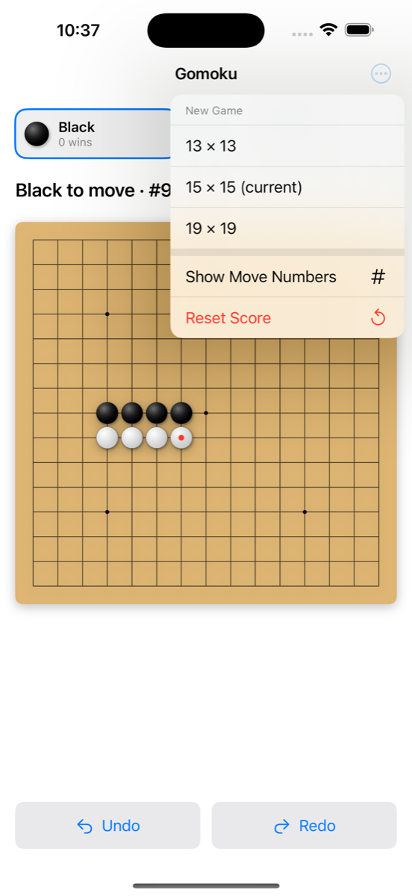

# Gomoku

Two-player, same-device Gomoku for iPhone and iPad (SwiftUI, iOS 17+). Black moves first; five or more in a row wins.

Features: unlimited undo/redo, 13/15/19 boards, win highlight, move numbers, running score, auto-save.

<p align="center">
  
  
  
</p>

## Install

Download from [Releases](../../releases/latest):

- `Gomoku-simulator.zip` — unzip, then `xcrun simctl install booted Gomoku.app`
- `Gomoku-unsigned.ipa` — unsigned; sideload with your own signing (e.g. AltStore, Sideloadly)

## Build

```bash
xcodegen generate && open Gomoku.xcodeproj
```

## License

MIT
